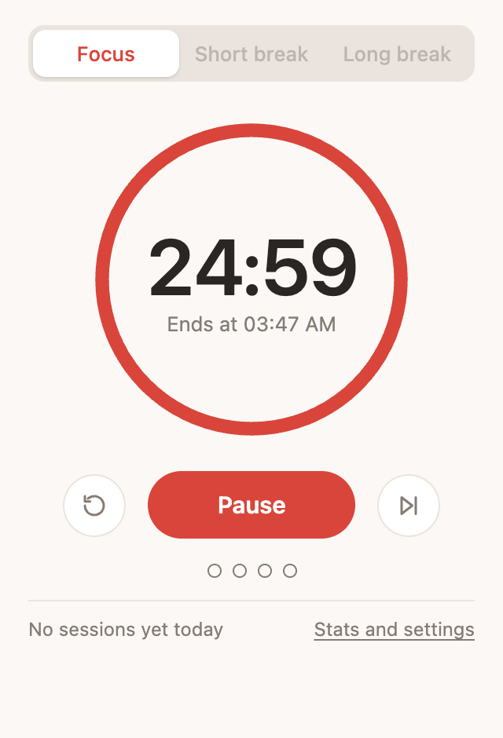
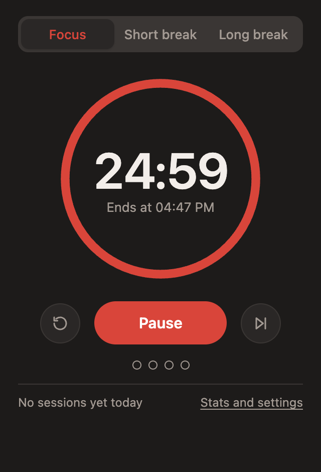
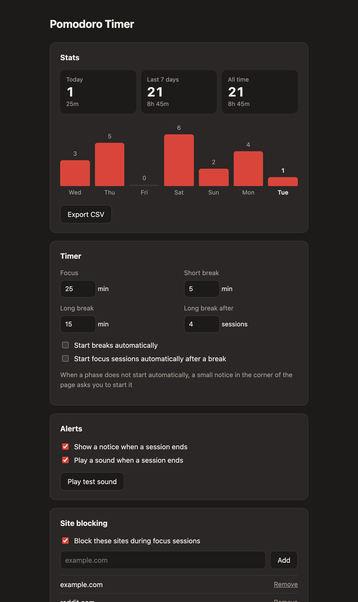

# Pomodoro Timer

A Chrome extension with a pomodoro timer, automatic breaks, daily stats and site blocking.

<p>
  
  
  
</p>

## Features

- Focus, short break and long break phases (25, 5 and 15 minutes by default)
- A long break after every 4 focus sessions
- Minutes left on the toolbar icon
- A notice with a start button and a chime when a session ends
- Sessions per day, with a 7-day chart and CSV export
- Optional blocking of chosen sites during focus sessions
- Light and dark mode, following your system theme
- `Alt+Shift+P` starts or pauses the timer

## Install

The extension is not on the Chrome Web Store, so you load it from a folder on your computer. It takes about two minutes.

### 1. Download the code

1. Open the [latest release](https://github.com/danilofreire/pomodoro/releases/latest) and click "Source code (zip)"
2. Extract the ZIP file. On macOS, double-click it. On Windows, right-click it and choose "Extract All"
3. You now have a folder named `pomodoro-` plus the version number, such as `pomodoro-1.0.0`. Move it somewhere it can stay, such as `Documents`

Chrome runs the extension from this folder. If you move or delete the folder later, the extension stops working.

If you use Git, you can clone the repository instead:

```bash
git clone https://github.com/danilofreire/pomodoro.git
```

### 2. Load it in Chrome

1. Type `chrome://extensions` in the address bar and press Enter
2. Turn on "Developer mode" (the switch in the top right corner)
3. Click "Load unpacked"
4. Select the folder you extracted (the one that contains `manifest.json`) and confirm

"Pomodoro Timer" now appears in your list of extensions.

### 3. Pin it to the toolbar

1. Click the puzzle icon to the right of the address bar
2. Click the pin next to "Pomodoro Timer"

The tomato icon stays visible, and it shows the minutes left while the timer runs.

The same steps work in other Chromium browsers, such as Edge and Brave. Use `edge://extensions` or `brave://extensions` in step 2.

## How to use it

Click the tomato icon to open the timer.

- "Start" begins a focus session. The button then becomes "Pause"
- The circular arrow resets the current phase
- The arrow on the right skips to the next phase. Skipped sessions do not count in your stats
- The tabs at the top switch between focus, short break and long break
- The dots show how many focus sessions you have done before the next long break

Nothing starts without you. When a focus session ends, you hear a chime and a small notice appears in the top right corner of the page you are on. It tells you how many minutes have passed. Click "Start break" to begin the break, or "Not now" to hide the notice and start later from the popup. The same notice appears when a break ends, with a "Start focus" button.

While the timer waits for you, the toolbar icon shows "!". You also get a system notification, which helps when Chrome is not the window in front. Clicking it starts the next phase.

If you prefer breaks or focus sessions to start by themselves, tick the two "automatically" boxes in the settings.

If your computer sleeps or Chrome is closed past the end of a session, that session is not counted. The timer waits at a new focus session.

### Settings and stats

Click "Stats and settings" at the bottom of the popup. There you can:

- See your sessions for today, the last 7 days and all time
- Click "Export CSV" to save every recorded day as a file (date, sessions, minutes)
- Change the length of each phase and the number of sessions before a long break
- Choose whether breaks and focus sessions start automatically
- Turn the notice and the sound on or off

Changes save as soon as you make them.

### Block distracting sites

1. Open "Stats and settings"
2. Tick "Block these sites during focus sessions"
3. Type a domain, such as `youtube.com`, and click "Add"

During a focus session, these sites show a countdown page. They reopen by themselves when the session ends.

## Update

1. Download the ZIP file of the newest version from the [releases page](https://github.com/danilofreire/pomodoro/releases/latest), extract it, and copy its contents over the files in your existing folder (or run `git pull` if you cloned it)
2. Open `chrome://extensions` and click the reload arrow on the "Pomodoro Timer" card

Your settings and stats are kept, as long as the folder stays in the same place.

## Uninstall

Open `chrome://extensions`, click "Remove" on the "Pomodoro Timer" card, then delete the folder. This also deletes your settings and stats, so export the stats first if you want to keep them.

## Troubleshooting

| Problem | Fix |
|---------|-----|
| "Manifest file is missing or unreadable" | You selected the wrong folder. Pick the one that contains `manifest.json`. Some unzip tools create a second folder with the same name inside the first |
| No system notification | Allow notifications for Chrome in your system settings. On macOS: System Settings, Notifications, Google Chrome |
| No notice in the corner of the page | Chrome does not allow it on its own pages, such as a new tab or `chrome://extensions`. Use the popup or the system notification there |
| No sound | Check that "Play a sound when a session ends" is ticked, then click "Play test sound" |
| A blocked site still opens | Blocking is active only during a focus session, and only if the tick box in settings is on |
| The shortcut does nothing | Another extension may use it. Set a new one at `chrome://extensions/shortcuts` |
| Chrome shows a "Developer mode extensions" warning | This is normal for extensions loaded from a folder |

## Privacy and permissions

Your settings and stats stay in your browser. The extension sends nothing over the internet.

Chrome lists the permission "Read and change all your data on all websites". The extension uses it for two things: site blocking redirects the sites on your list, and the end-of-session notice is drawn in the corner of the page you are on. It checks tab addresses against your list and does not read page content.

## Files

| File | Role |
|------|------|
| `manifest.json` | Extension description and permissions |
| `background.js` | The timer: alarms, badge, notifications, stats, blocking rules |
| `shared.js` | Defaults and helpers used by every page |
| `popup.*` | The timer window that opens from the toolbar |
| `options.*` | Stats and settings page |
| `blocked.*` | Page shown in place of a blocked site |
| `offscreen.*` | Plays the chime |

## Licence

[MIT](LICENSE)
